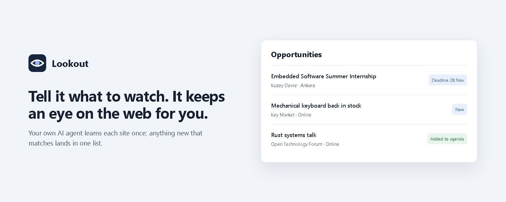
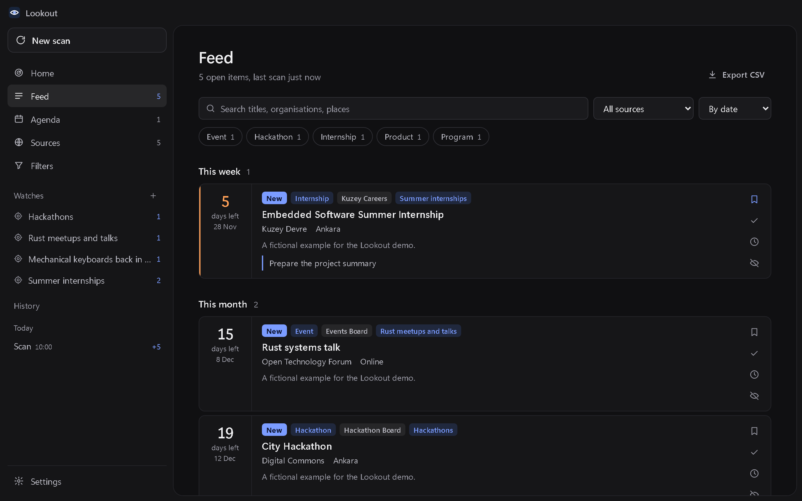
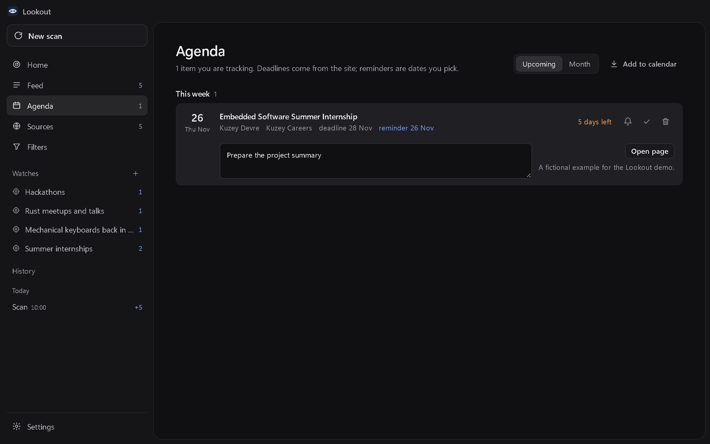
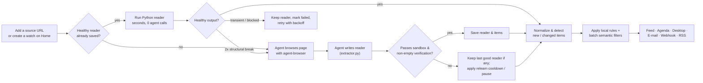

<p align="center"></p>

Lookout is a local web monitor that uses your coding-agent CLI to learn sites and collect matching updates.

## Quick start

A supported signed-in agent CLI uses its own subscription and quota; pages, item details, and prompts may be sent to its provider. See [first-run expectations](#first-run-time-and-quota-expectations) and [agent support](#supported-agents--permission-modes).

**Prerequisites:**

- Python 3.10+ (stdlib only for the server and browser UI; optional `pywebview>=5` for a frameless desktop window)
- Google Chrome / Chromium (on Linux desktop mode, `pywebview` also needs WebKitGTK / Qt WebEngine; `--browser` mode needs only any web browser)
- Node.js (for `agent-browser`)
- At least one supported agent CLI installed and signed in (unless you only use local `plugins/`)

```bash
# 1. Install the browser CLI used by agents and JS readers
npm install -g agent-browser
agent-browser install

# 2. Clone and run Lookout (standard git clone or editable package install)
git clone https://github.com/1eminguler/lookout.git
cd lookout

# Option A: run directly with zero Python dependencies (opens in browser if pywebview is absent)
python run.py

# Option B: install via pyproject.toml / pip (or pipx) with optional desktop window extra
pip install -e .                 # or: pip install -e ".[desktop]"
lookout                          # or: lookout --browser
```

If `pywebview` is not installed or cannot initialize a native window backend, Lookout automatically falls back to opening your default web browser at `http://127.0.0.1:8780/?k=<one-time-launch-secret>`. A PID lockfile (`data/window.pid`) prevents duplicate native windows and prints the active URL if Lookout is already open.

1. Open **Settings** → pick your agent and default model.
2. Open **Home** → describe what you want to follow (creates a watch + finds sources), or go to **Sources** → add listing URLs directly.
3. Review **Filters** → refine global or watch-specific rules.
4. Run **New scan**, then optionally enable **Daily scan** and notifications in **Settings**.

From a terminal or scheduler:

```bash
python run.py scan               # or: lookout scan
```

## A tour

Start on **Home** to describe what you want to watch. Open **Feed** to see matches across watches and save an item to your agenda.



In **Sources**, add a listing URL or check the status of a source you already follow.


In **Agenda**, open a saved item to add a note or set a reminder.



In **Settings**, choose your agent, daily scan time, desktop notifications, and appearance. System follows your device, or you can choose Light or Dark.


## Contents

- [Core concepts: where to start](#core-concepts-where-to-start)
- [How it works](#how-it-works)
- [First-run time and quota expectations](#first-run-time-and-quota-expectations)
- [How self-healing works — and its limits](#how-self-healing-works--and-its-limits)
- [Docker (isolated execution)](#docker-isolated-execution)
- [Environment variables](#environment-variables)
- [Supported agents & permission modes](#supported-agents--permission-modes)
- [Filters](#filters)
- [Plugins](#plugins)
- [Which sites work (and legal / ToS note)](#which-sites-work-and-legal--tos-note)
- [Scheduling, notifications & backups](#scheduling-notifications--backups)
- [Safety & Security](#safety--security)
- [How it compares](#how-it-compares)
- [Troubleshooting](#troubleshooting)
- [Uninstall](#uninstall)
- [Run the tests](#run-the-tests)
- [Contributing](#contributing)

## Core concepts: where to start

Lookout has four building blocks. Pick the entry point that matches how you work:

1. **Watches (start on Home if you want AI discovery):** A **watch** is a topic folder in the sidebar (e.g., *"ML internships in Berlin"*). Describe what you want on **Home**: Lookout creates a watch, searches the web for listing pages, turns your prompt into watch filters, adds the confirmed sources, and runs the watch's first scan. You can edit a watch's title or search prompt inline and click **Search again** at any time.
2. **Sources (start on Sources if you already know the URLs):** A **source** is a single listing page (or local plugin). Sources can belong to a specific watch or stay **global**. The main **Feed** shows matching open items across all global and watch sources (with watch badges and source filters), while each watch page shows only that watch's items. If the same URL is added in multiple places with the **same notes and active filters**, Lookout shares the learned reader automatically; if two watches use different notes or filters on the same URL, each keeps its own specialized reader.
3. **Filters — global vs. watch:**
   - **Global filters** (in **Filters**) apply to *every* watch and global source.
   - **Watch filters** (inside a watch's page) apply *only* to that watch's sources (combined with active global filters).
   - Deterministic rules (`exclude` keywords, `deadline_within`, expired deadlines) run locally in Python; semantic rules (`include`, `type`, `location`, `instruction`) are checked in batches by your agent.
4. **Plugins (optional, zero agent quota):** Short Python scripts in `plugins/` for sites with clean public JSON APIs or fixed endpoints. Plugins appear alongside regular sources, require no agent CLI at all, and never consume agent quota.

## How it works



1. **Learn:** When a source has no saved reader yet, Lookout writes `TASK.md` in an isolated temporary folder. Your agent opens the URL in [`agent-browser`](https://github.com/vercel-labs/agent-browser) (using a per-source session name `lookout-<id>-<slug>`), inspects the DOM and any underlying JSON/GraphQL endpoints, saves up to **200** visible listings to `results.json`, and writes `extractor.py`.
2. **Verify:** Lookout checks `extractor.py` against a static AST allow-list (`lookout/extractors.py`), runs `fetch()` inside an isolated `python -I` subprocess (`lookout/lookout_extract.py`), and verifies that both `results.json` and `fetch()` returned non-empty listings with matching titles/URLs, healthy field fill rates, and low duplication (`extractors.agrees` returns `UNVERIFIED` when `results.json` is empty, so an empty agent run never verifies a broken reader).
3. **Read:** Subsequent scans execute the verified reader directly in Python. Each source uses the reader's listing ID when supplied, or the listing's URL and title otherwise. The Feed displays one card per stored item ID, so programmes that share a link stay separate. Tracked field changes (`title`, `org`, `category`, `deadline`, `start_date`, `location`), closures, and reopenings are recorded in `item_history`. Summary and extra fields update in place without creating an Updated entry.
4. **Filter:** Deterministic exclusions (including Turkish `İ`/`i` normalization) and deadline rules run locally. Excluded non-expired items are saved with `match=0` (`det_excluded`) and refreshed on each scan so `mark_gone` never falsely records them as closed. If semantic filters are active, Lookout sends unchecked open items in batches of up to 80 to the agent with a strict data-only prompt (`CLASSIFY`) and no browsing tools. When classification inputs change, the previous decision is cleared. Missing decisions remain pending for the next scan.
5. **Heal:** When a reader fails structurally on **2 consecutive scans**, Lookout hands it back to the agent with the error message to repair while preserving `last_good_extractor` until a replacement verifies.

## First-run time and quota expectations

Different steps use very different amounts of time and agent quota:

| Phase | Agent calls | Typical time | What happens |
|---|---|---|---|
| **Discover** (Home prompt) | 1 session | ~3–16 min (timeout `agent_timeout_min + 4`, default 16 min) | Agent searches the web, verifies candidate listing pages, drafts watch filters, and streams confirmed sources into an early scan while discovery finishes. |
| **Learn** (new or broken site) | 1 session per unique `(URL, notes, filters)` context | ~2–12 min per site (capped by `agent_timeout_min`, default 12 min) | Agent drives Chromium via `agent-browser` and writes `extractor.py`. Multiple sources learn concurrently up to the **parallel** setting (default `2`), and items appear progressively as each source finishes. A new watch with 6–8 sites can easily take **10–25+ minutes** on its very first scan. |
| **Read** (healthy reader) | **0 calls** | **A few seconds** | Runs saved Python readers directly (or local plugins). No agent CLI is launched. |
| **Filter** (semantic rules) | 1 short batch call per scope with unchecked items (0 if none) | ~10–45 sec | Agent reads `items.json` locally (no browsing or shell commands) in batches of up to 80 items. |
| **Test this source** (preview) | **0 calls** if reader exists; **1 quick session** if unlearned | Seconds with reader; ~2–4 min if unlearned | Runs asynchronously with a **Stop** button. Uses the saved/shared Python reader if one exists; otherwise runs a 2–4 minute agent browser preview (`quick_read_source`) that consumes quota and does not save a reader. |
| **Weekly check** (`verify_weekly`, triggered during scans) | **0 calls** if healthy; 1 learn session only if anomalous | Seconds when healthy | During a scan, if a reader is >7 days old, Lookout runs the saved Python reader first; it only launches an agent session if output looks anomalous vs. history (and bumps `extractor_updated` even on fallback so it won't re-trigger every scan). Can be turned off in Settings. |

> **Tip:** You can watch progress per source while a scan runs, or switch to a faster/cheaper model in the Home/Settings picker for routine sites and reserve heavier models for complex JavaScript pages.

## How self-healing works — and its limits

Lookout separates temporary outages and bot walls from actual website redesigns:

- **Transient errors keep the reader:** Connection resets, timeouts (`extractor took longer than Ns`), DNS/TLS errors, Windows socket errors, HTTP 5xx, HTTP 429, and **unrecognized errors** default to **transient**. They never invalidate a working reader; the source backs off exponentially (`5m`, `10m`, … up to `6h`). Clicking **New scan** in the UI bypasses transient backoff so you can retry immediately after reconnecting.
- **Blocked pages do not trigger relearns:** HTTP 401/403/451 responses, Cloudflare challenges, CAPTCHA gates, and access-denied pages are classified as **blocked** (`BlockedError`). Lookout keeps the existing reader and applies a backoff cooldown instead of burning agent quota on a bot wall.
- **Consecutive structural failures trigger repair:** Syntax/runtime errors in the reader (`KeyError`, `ValueError`, invalid JSON, HTTP 404/410) or rows missing valid titles and `http(s)` links increment `struct_fail_count` and trigger a relearn after **2 consecutive structural failures**.
- **Empty reads require confirmation:** After a source has returned listings, the first empty read keeps them open and is recorded as suspect in scan history. A second consecutive empty read closes them. A reader can confirm an empty listing immediately by returning only `[{"empty": True}]` from `fetch()`.
- **Relearn cooldown and automatic pause:** If a learn or relearn attempt fails or produces an unverified reader, Lookout preserves `last_good_extractor`, increments `learn_fail_count`, and waits with exponential cooldown (`30m`, `60m`, … up to `24h`). After **3 consecutive learn failures**, the source is automatically **paused** (badged `paused` in the UI with a **Resume** button) so unattended scans never loop forever on an unscrapable site.
- **Filter and note change detection (`filters changed`):** Learned readers store a `filter_hash` of the active filters and source notes used when they were learned. When you edit filters or source notes, affected learned sources display a `filters changed` badge and a **Relearn** button while continuing to run their existing reader until you choose to relearn.

**Where self-healing cannot see everything:**

- **Silent wrong-tab or stale-section reads:** If a site layout changes so the reader still parses plausible counts of valid-looking titles and URLs from the wrong tab (or an archive page), Lookout cannot detect semantic drift automatically. Use **Test** or click **Relearn** on that source.
- **Filter changes vs. learned sections:** Editing filters immediately re-evaluates deterministic rules (`exclude`, `deadline_within`) on stored open items and queues semantic rules (`include`, `type`, `location`, `instruction`) for the next scan. However, if a reader was originally written to fetch only a specific site tab (e.g., *"Full-time"* instead of *"Internships"*), click **Relearn** on sources badged `filters changed` so the agent inspects the new section.
- **Date formats:** `scanner.parse_date()` parses ISO (`YYYY-MM-DD`), day-first numeric (`DD.MM.YYYY` / `DD/MM/YYYY`), and English/Turkish month names (`15 Jan 2027`, `Jan 15, 2027`, `15 Nisan 2027`). Ambiguous US numeric dates (`MM/DD/YYYY` where `MM <= 12`) and dates without a 4-digit year are not supported unless the reader normalizes them to `YYYY-MM-DD`.

## Docker (isolated execution)

Because most coding-agent CLIs run with auto-approve flags (`--yolo`, `--dangerously-skip-permissions`, etc.), running Lookout inside a container isolates agent file and shell access from your host home directory (`~/.ssh`, `~/.aws`, browser profiles).

The included [`Dockerfile`](Dockerfile) uses `python:3.13-slim`, installs Node.js, `agent-browser`, and system Chromium, runs as a non-root `lookout` user with `/data` as a volume, and starts Lookout in headless mode. CI builds the image and signs in to it on every push.

```bash
# Pick the agent CLIs to bake in: claude, codex, gemini (space separated). Leave it out for none.
docker build --build-arg AGENTS="codex" -t lookout .

# Publish ONLY on host loopback (127.0.0.1); the server only accepts Host: 127.0.0.1:8780 / localhost:8780.
docker run -d --name lookout -p 127.0.0.1:8780:8780 -v lookout-data:/data lookout

# Sign in: open the one-time link the container printed.
docker logs lookout | grep "k="
# Later, or after the link was used: print the current one
docker exec lookout python run.py --print-url

# Log the agent in once, inside the container (kept in the container's home directory),
# by starting it and following its sign-in steps:
docker exec -it lookout codex
```

Each sign-in link works once; after it is used, the container prints the next one. Without an agent in the image, Lookout still runs scans with readers it already learned and with plugins, but it cannot learn new sites or find sources. Prefer logging the agent in inside the container over mounting your host home directory.

`python run.py --headless` (or `LOOKOUT_HEADLESS=1`) works outside Docker too, for example on a home server: it serves without opening a window and prints each sign-in link.

## Environment variables

| Variable | Default | Purpose |
|---|---|---|
| `LOOKOUT_DATA_DIR` | `./data` | Directory storing `lookout.db` (plus `-wal`/`-shm`), `agent_command.txt`, `window.pid`, and `.launch_secret`. |
| `LOOKOUT_PLUGIN_DIR` | `./plugins` | Directory scanned for local Python source plugins (`*.py` not starting with `_`). |
| `LOOKOUT_PORT` | `8780` | Local TCP port for the web UI and HTTP API. |
| `LOOKOUT_BIND` | `127.0.0.1` | Bind address for the HTTP server (use `0.0.0.0` only inside a container paired with `-p 127.0.0.1:8780:8780`). |
| `LOOKOUT_USER_AGENT` | `Lookout/0.3.0 (+https://github.com/1eminguler/lookout)` | Default `User-Agent` sent by reader HTTP helpers (`get`, `get_json`, `post_json`, `allowed`) and webhooks. |
| `LOOKOUT_MIN_INTERVAL` | `0.5` | Minimum per-host delay in seconds between requests in `lookout_extract.py` (`0` to disable). |
| `LOOKOUT_RESPECT_ROBOTS` | `0` (`False`) | Set to `1` (`true`) to make `get`, `get_json`, `post_json`, and `browser_eval` enforce `allowed(url)` against the site's `robots.txt` automatically. |

## Supported agents & permission modes

Adapters marked **CLI `--help` checked** in [`lookout/agents.py`](lookout/agents.py) had their command-line flags verified against `--help` on real installations; **experimental** adapters have not yet been verified against live installations, and vendor CLI updates can change flag behavior at any time.

| Agent | Flags passed by Lookout | Status | Permission mode |
|---|---|---|---|
| [Claude Code](https://docs.anthropic.com/en/docs/claude-code) | `claude -p … --add-dir <dir> --permission-mode acceptEdits --allowedTools <task-scoped-tools>` (see task table below and [SECURITY.md](SECURITY.md)) | CLI `--help` checked | **Tool-restricted per task** |
| [Gemini CLI](https://github.com/google-gemini/gemini-cli) | `gemini -p … --yolo [--sandbox]` (+ `-m <model>`) | `--sandbox` added only if `--help` lists it | **Conditional CLI sandbox** |
| Antigravity CLI | `agy -p … --add-dir <dir> --dangerously-skip-permissions --print-timeout <t>s` (+ `--model <model>`) | CLI `--help` checked | **Auto-approve** |
| [opencode](https://opencode.ai) | `opencode run … --auto` (+ `-m <model>`) | CLI `--help` checked | **Auto-approve** |
| [Codex CLI](https://github.com/openai/codex) | `codex exec <prompt> -C <workdir> --skip-git-repo-check --ephemeral -s workspace-write -c sandbox_workspace_write.network_access=true` (+ `-m <model>`); on Windows `-s danger-full-access` | CLI `--help` checked | **Workspace-write sandbox with network access** (macOS/Linux); **no sandbox** on Windows |
| Cursor Agent | `cursor-agent -p … --force` (+ `--model <model>`) | experimental | **Auto-approve** |
| Qwen Code | `qwen -p … --yolo` (+ `-m <model>`) | experimental | **Auto-approve** |
| GitHub Copilot CLI | `copilot -p … --allow-all-tools` (+ `--model <model>`) | experimental | **Auto-approve** |
| Custom command | Local template from `data/agent_command.txt` or `--custom-command` (`{prompt}`, `{model}`, `{dir}`) | custom | **User-defined (local config only)** |

**Claude Code per-task `--allowedTools` (`CLAUDE_TASK_TOOLS`):**

- **`classify` (semantic filtering):** `Read`, `Write` only — **no** `agent-browser`, **no** `WebFetch`/`WebSearch`, **no** `Edit`, and **no** `Bash`.
- **`quick_read` (unlearned source test preview):** `Bash(agent-browser:*)`, `Bash(agent-browser *)`, `Read`, `Write`.
- **`learn` (learn/repair reader):** `Bash(agent-browser:*)`, `Bash(agent-browser *)`, `Bash(python test_extractor.py)`, `Bash(python3 test_extractor.py)`, `Read`, `Write`, `Edit`, `WebFetch`.
- **`discover` (find sources):** `Bash(agent-browser:*)`, `Bash(agent-browser *)`, `Read`, `Write`, `Edit`, `WebSearch`, `WebFetch`.

**Custom command configuration (local-only):** For security, `custom_command` cannot be viewed or modified over the HTTP API (`POST /api/settings` rejects it with `403`). Configure it locally either by placing the command template on the first non-comment line of `data/agent_command.txt` (inside `LOOKOUT_DATA_DIR`) or by starting Lookout with `python run.py --custom-command "my-cli run -m {model} {prompt}"`.

**Quota handling:** Lookout scans stderr (last 40 lines) and the last 15 lines of stdout on non-zero agent exits for quota/429 messages (avoiding false positives on scraped page text). It parses relative durations (`resets in 2h 15m`, `try again in 30m`), ISO 8601 timestamps, and clock times (`resets at 14:30`, `available at 9:15 am UTC`), and applies a **30-minute default cooldown** whenever a quota error includes no parseable reset time. Cooldown timestamps are preserved across subsequent failed calls until a call succeeds.

## Filters

| Type | Example | Enforced by |
|---|---|---|
| Must match (`include`) | `software engineering, machine learning, data roles` | agent (on Learn section choice + batch Classify) |
| Exclude (`exclude`) | `senior, unpaid, sales` | agent and Lookout (local regex word match with Turkish `İ`/`i` normalization) |
| Kinds of items (`type`) | `internships, hackathons, grants` | agent |
| Location (`location`) | `remote, or anywhere in Europe` | agent |
| Deadline within (`deadline_within`) | `30` (days) | agent and Lookout (local date check) |
| About you (`instruction`) | `I am a final-year computer science student` | agent |

Lookout also drops items whose parsed deadline has already passed. When you add, edit, toggle, or delete a filter, Lookout immediately re-evaluates deterministic filters (`exclude`, `deadline_within`, expired deadlines) against all stored open items in that scope and clears `match_key` on open items so semantic filters re-classify them on the next scan.

## Plugins

A plugin is a Python file in `plugins/` exposing `SOURCES = [{"name": ..., "url": ..., "fetch": fn}]`. Plugins run in-process, execute in seconds, and require zero agent calls or agent CLI setup. Files beginning with `_` are ignored by the loader (copy [`plugins/_example_hn_jobs.py`](plugins/_example_hn_jobs.py) to start). Your personal `.py` files in `plugins/` are git-ignored. See [plugins/README.md](plugins/README.md).

## Which sites work (and legal / ToS note)

- **Works well:** Public server-rendered HTML listing pages, public JavaScript single-page apps readable without signing in, public JSON/GraphQL APIs behind listing pages, and official organization careers, grants, or competition portals.
- **Works poorly or fails:** Sites behind logins or paywalls, aggressive bot walls/CAPTCHAs (such as Cloudflare Turnstile or DataDome — these are marked `blocked` and backed off rather than relearned), multi-step authenticated forms, or pages whose listings lack titles or item URLs.
- **Reader etiquette & `robots.txt`:** Reader HTTP helpers in [`lookout/lookout_extract.py`](lookout/lookout_extract.py) send an honest default `User-Agent` (`Lookout/0.3.0 (+https://github.com/1eminguler/lookout)`, configurable via `LOOKOUT_USER_AGENT`), enforce a per-host minimum request interval (`0.5s` by default, configurable via `LOOKOUT_MIN_INTERVAL`), and provide an `allowed(url)` helper for `robots.txt` checks (enforced automatically on `get`, `get_json`, `post_json`, and `browser_eval` when `LOOKOUT_RESPECT_ROBOTS=1` or `respect_robots=True`).
- **Legal & Terms of Service:** Respect each site's Terms of Service, `robots.txt`, and reasonable request rates. Lookout does not bypass logins, paywalls, or anti-bot/CAPTCHA checks; for platforms that prohibit automated reading, use their native alerts or official APIs instead.

## Scheduling, notifications & backups

### Daily background scans and scheduler `PATH`

Enable **Daily scan** in **Settings** to run `python run.py scan --scheduled` automatically once a day, even when the UI is closed. A cross-process lock with a 15-second heartbeat in SQLite prevents scheduled scans, manual UI scans, and background discoveries from colliding.

- **Windows:** Registers a Windows Task Scheduler task named `LookoutDailyScan` (with missed-run catch-up).
- **macOS:** Installs a `launchd` user agent (`com.lookout.dailyscan` in `~/Library/LaunchAgents/`) or falls back to a user `crontab` entry.
- **Linux:** Installs a `systemd --user` timer (`lookout-scan.timer` and `lookout-scan.service` in `~/.config/systemd/user/`) or falls back to a user `crontab` entry.
- **Environment & `PATH` capture (macOS / Linux):** `cron`, `systemd --user`, and `launchd` normally start jobs with a minimal default `PATH` that omits `~/.local/bin`, `nvm`, or Homebrew (`/opt/homebrew/bin`). When you enable **Daily scan** (or preview configs in Settings), Lookout captures your current `PATH`, `LOOKOUT_DATA_DIR`, and `LOOKOUT_PLUGIN_DIR` into the generated cron line, systemd unit, or launchd plist. Use the **Run now** button in Settings (`POST /api/schedule/test` / `notify.run_schedule_now()`) or the displayed self-test command to verify that your scheduler environment can find `python`, `node`, `agent-browser`, and your agent CLI. If you later move your agent CLI binary to a different directory, toggle Daily scan off and back on to refresh the captured `PATH`.

### Unified notifications and feeds

All scan triggers (manual UI scans, CLI `python run.py scan`, and scheduled scans) run the same post-scan notifier (`scanner.notify_after_scan`):

- **Silent first-scan baseline:** The first successful scan of any newly added source records its initial items as a baseline (`baseline_done=1`, `notified=1`) without firing desktop, e-mail, or webhook alerts. Subsequent scans notify you only about newly appeared items and tracked changes (`deadline_moved`, `reopened`, `updated`).
- **Delivery confirmation & error banner:** Items are marked `notified=1` only when all configured remote channels (e-mail and/or webhook) succeed (or when the desktop notification succeeds if no remote channels are configured). Failed deliveries are recorded in `notification_log` and displayed in a dismissible warning banner at the top of Home, Feed, and Settings.
- **Desktop alerts:** Windows toast (`powershell.exe`), macOS Notification Center (`osascript`), or Linux (`notify-send`) for new/updated items and due agenda reminders. When a CLI/scheduled scan triggers a desktop alert while the UI is not running, `run.py` spawns a detached background UI server (`python run.py --background`, with `start_new_session=True` on POSIX and a 12-hour idle shutdown) so clicking the notification opens Lookout.
- **E-mail digest (optional):** Sends HTML + plain-text digests for new and updated items. Supports a configurable `From` address (`mail_from`, defaulting to `smtp_user`), multiple comma/semicolon-separated `mail_to` recipients, TLS certificate verification (`ssl.create_default_context()`), port `465` (`SMTP_SSL`), configurable `STARTTLS` (`auto` when offered by the server, `always`, or `never`), and unauthenticated local SMTP relays. Note that `smtp_password` is stored in `data/lookout.db` (not an OS keyring).
- **Webhooks (optional):** Supports **Auto-detect**, **Generic JSON**, **Slack** (Block Kit), **Discord** (embeds), **Telegram Bot API** (`sendMessage` with `telegram_chat_id` or `?chat_id=`), and **ntfy** (plain text + `Title`/`Click`/`Tags` headers). Private/loopback webhook targets are blocked by default unless explicitly opted in.
- **Per-watch RSS/Atom (optional):** `/api/watches/<id>/feed.xml` and `/atom.xml` strip XML-illegal control characters. Requiring a session cookie by default, they can be toggled in Settings to allow unauthenticated access **from the same computer (`127.0.0.1` / `localhost`) while Lookout is running**.

### Backup scope (read before relying on JSON export)

- **JSON export/import (`/api/backup.json`):** Exports and imports **watches, non-plugin sources, and filters ONLY**. It **intentionally omits** secrets (`smtp_password`), **learned readers**, **collected items**, **agenda notes/reminders**, and **scan/discovery history**. Restoring from JSON into a fresh database requires relearning each source on the next scan.
- **Full backup:** Stop Lookout and copy the entire `data/` directory — including `lookout.db`, `lookout.db-wal`, `lookout.db-shm`, and `agent_command.txt` — or run `sqlite3 data/lookout.db ".backup lookout-backup.db"` to preserve learned readers, items, agenda state, history, and settings.

## Safety & Security

- **Local auth & session cookie:** Binds to `127.0.0.1` by default (`LOOKOUT_BIND`), validates `Host`, `Origin`, `Referer`, and `Sec-Fetch-Site` headers, and authenticates the browser via a **one-time launch secret** (`/?k=<secret>`) exchanged for an `HttpOnly; SameSite=Strict` session cookie (`lookout_session`). No API token is ever embedded in `index.html`.
- **`custom_command` out of HTTP:** Custom agent commands cannot be read or written over HTTP (`POST /api/settings` rejects `custom_command` with `403`); they are loaded only from `data/agent_command.txt` or `--custom-command`.
- **Strict CSP & framing headers:** Every response sends `Content-Security-Policy: default-src 'self'; img-src 'self' data:; frame-ancestors 'none'`, `X-Frame-Options: DENY`, `Referrer-Policy: no-referrer`, `X-Content-Type-Options: nosniff`, and `Cache-Control: no-store`.
- **Export sanitization:** `/api/export.csv` neutralizes spreadsheet formulas (`= + - @ \t \r`), `/api/agenda.ics` escapes text fields while preserving raw control-char-stripped `URL:` values and RFC 5545 75-octet line folding, and RSS/Atom feeds strip XML control characters.
- **SSRF protection:** Reader HTTP/browser helpers (`lookout/lookout_extract.py`, including `allowed()` robots.txt fetches) and webhooks (`lookout/notify.py`) resolve DNS and block loopback, RFC 1918 private, link-local, CGNAT, multicast, unspecified, and local IPv6/hostname targets across HTTP redirects.
- **Reader sandbox:** Generated readers (`extractor.py`) are checked against a single-source-of-truth AST allow-list and executed inside an isolated `python -I` subprocess with restricted builtins, output/HTTP byte caps, timeouts, and process-tree termination.

See **[SECURITY.md](SECURITY.md)** for the full threat model, exact per-agent CLI flags, residual limits, and private vulnerability reporting.

## How it compares

| | Lookout | [changedetection.io](https://github.com/dgtlmoon/changedetection.io) | [Firecrawl Open Scouts](https://github.com/firecrawl/open-scouts) | LLM scraping libraries ([crawl4ai](https://github.com/unclecode/crawl4ai), …) |
|---|---|---|---|---|
| **Cost / API requirement** | Uses your existing coding-agent CLI subscription (0 agent calls on healthy reads) | **Zero LLM cost** (free self-hosted) | Requires Firecrawl API key (+ OpenAI/LLM key) | LLM API keys per run (or local model) |
| **Extraction model** | Agent writes a reusable Python reader (`extractor.py`) per site | Mature visual CSS/XPath/JSON selectors & text/HTML diffs | Cloud search + Firecrawl scrape pipeline | Code-driven LLM/DOM extraction |
| **Layout-change handling** | Agent repairs broken readers after 2 structural failures (with last-good rollback & pause after 3 failed learns) | Alerts on selector errors / diffs | Re-runs cloud search/extraction | You update selectors/prompts |
| **Logins & browser steps** | **No** (public pages only) | **Yes** (Playwright/Puppeteer browser steps & logins) | Public web | Configurable in code |
| **Filtering** | Plain-language batch agent filter + local deterministic rules | Text/regex/JSONPath triggers | Natural-language scout prompt | Custom code / LLM prompts |
| **Notifications** | Desktop, TLS SMTP, Slack/Discord/Telegram/ntfy/JSON webhooks, localhost RSS/Atom | **Apprise** (dozens of services), webhooks, e-mail | E-mail / webhook notifications | DIY |
| **Deadlines & agenda** | Built-in deadline parsing, item change tracking, agenda & `.ics` | General page monitoring (no agenda) | Feed of scout matches | DIY |
| **Deployment** | Local Python/SQLite app (`run.py`, `pipx`, or `Dockerfile`) | **Mature official Docker stack, server-ready** | Next.js / hosted web app | Python library |

## Troubleshooting

- **Desktop window doesn't open (e.g., Linux without GTK/Qt WebKit):** Run `python run.py --browser`. On `pywebview` startup failures, `run.py` automatically falls back to opening your default web browser.
- **"Open Lookout from the app" gate page in browser:** For security, `/` does not hand out a session cookie without the one-time launch secret. Launch Lookout via `python run.py` (or if it is already running, read `data/.launch_secret` or restart `python run.py`). If the backend restarts while a tab is open, the UI automatically reloads cleanly to re-authenticate instead of showing a false crash message.
- **"`agent-browser` is missing" banner in Settings:** Install Node.js and Google Chrome/Chromium, then run `npm install -g agent-browser && agent-browser install`.
- **Scheduled daily scans fail on macOS/Linux while manual scans work:** Ensure **Daily scan** was enabled from a shell where `node`, `agent-browser`, and your agent CLI were on `PATH`, then click **Run now** in Settings (`POST /api/schedule/test`) to verify.
- **Source shows `paused` or `blocked`:** A `blocked` source hit an HTTP 401/403/451 or CAPTCHA/Cloudflare page and will retry after its cooldown without relearning. A `paused` source failed to learn 3 times in a row; inspect or edit its URL/notes and click **Resume** (or **Test**).
- **Running on a headless machine or home server:** Lookout binds to `127.0.0.1` by default and enforces `Host`, `Origin`, and launch-secret cookie checks — **putting a reverse proxy with a public hostname in front of Lookout will return `403` / `401`**. Run scheduled scans with `python run.py scan` and access the UI via an SSH local port forward:
  ```bash
  ssh -L 8780:127.0.0.1:8780 user@your-server
  ```
  Then open the printed `http://127.0.0.1:8780/?k=<secret>` launch URL in your local browser.

## Uninstall

1. Stop Lookout if it is running (close the desktop window or terminate `python run.py`).
2. **Remove the daily scan schedule** (turn **Daily scan** off in **Settings** before deleting files, or run the manual cleanup for your OS):
   - **Windows:**
     ```powershell
     schtasks /Delete /TN LookoutDailyScan /F
     ```
   - **Linux (`systemd --user`):**
     ```bash
     systemctl --user disable --now lookout-scan.timer
     rm -f ~/.config/systemd/user/lookout-scan.service ~/.config/systemd/user/lookout-scan.timer
     systemctl --user daemon-reload
     ```
   - **macOS (`launchd`):**
     ```bash
     launchctl bootout gui/$(id -u) ~/Library/LaunchAgents/com.lookout.dailyscan.plist 2>/dev/null || launchctl unload ~/Library/LaunchAgents/com.lookout.dailyscan.plist
     rm -f ~/Library/LaunchAgents/com.lookout.dailyscan.plist
     ```
   - **macOS / Linux (`crontab`):** run `crontab -e` and delete the line ending in `# lookout-daily-scan`.
3. Delete the cloned `lookout` directory (including `data/` and `plugins/`, or back up `data/` first if you want to keep your database). You can also remove temporary work folders `lookout_agent` and `lookout_extractor` from your OS temp directory if any remain.

## Run the tests

Tests use Python's built-in `unittest` module with temporary directories, ephemeral local ports, and fakes — no external network access and no real agent calls:

```bash
python -m unittest discover -s tests -v
node --check web/app.js
python -m compileall -q run.py lookout plugins tests
ruff check .
```

The Playwright UI smoke test (`tests/test_ui.py`) runs in CI (and locally whenever `playwright` and Chromium are installed; set `LOOKOUT_REQUIRE_UI_TEST=1` to fail instead of skipping if Playwright is missing).

## Contributing

Bug reports, security improvements, agent adapter updates, and plugin examples are welcome — see [CONTRIBUTING.md](CONTRIBUTING.md) and [SECURITY.md](SECURITY.md).

```
run.py                     app launcher, PID window lock, desktop window fallback, CLI scan command
lookout/agents.py          detects and runs agent CLIs, per-task Claude tools, quota cooldown parser
lookout/tasks.py           prompts and runners for Discover, Learn/Heal, Quick Read, and Classify
lookout/extractors.py      AST check, isolated subprocess runner, agrees(UNVERIFIED), run_and_compare
lookout/lookout_extract.py single-source-of-truth sandbox constants, SSRF, throttle, robots.txt helpers
lookout/scanner.py         scans, normalizes, filters, self-healing budget, unified post-scan notifier
lookout/server.py          loopback web UI, launch-secret cookie auth, CSP, JSON/CSV/ICS/RSS API
lookout/notify.py          desktop alerts, TLS SMTP digest, Slack/Discord/Telegram/ntfy/JSON webhooks, OS scheduling
lookout/db.py              SQLite storage, migrations, server-side item queries/counts, scan lock, item history
web/                       frontend UI (plain HTML, CSS, and JavaScript — no build step, CSP-clean)
plugins/                   optional zero-agent local Python source plugins
tests/                     offline unittest suite, Playwright UI smoke test, and local test helpers
Dockerfile                 rootless container image with Python 3.13, Node.js, agent-browser, and Chromium
pyproject.toml             package metadata, lookout CLI script entry point, optional extras, ruff config
SECURITY.md                threat model, agent permission flags, sandbox & SSRF boundaries
```

## License

[MIT](LICENSE)
