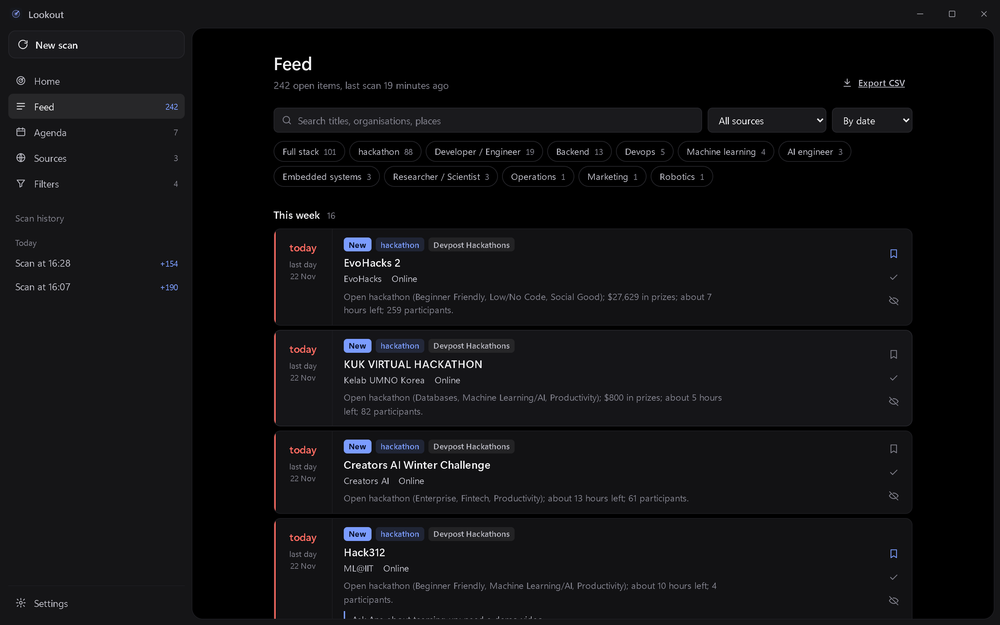
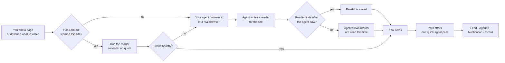
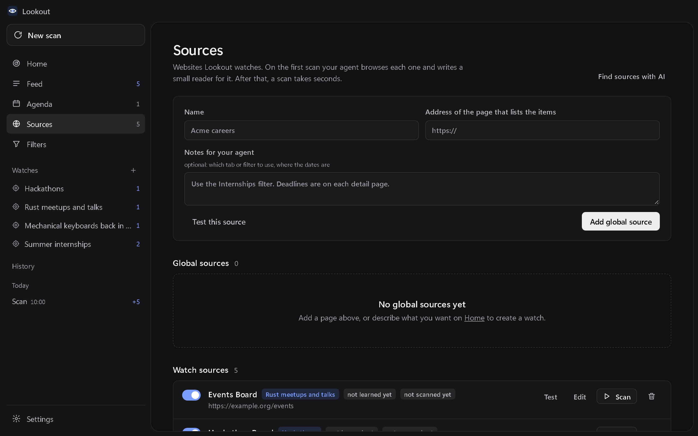
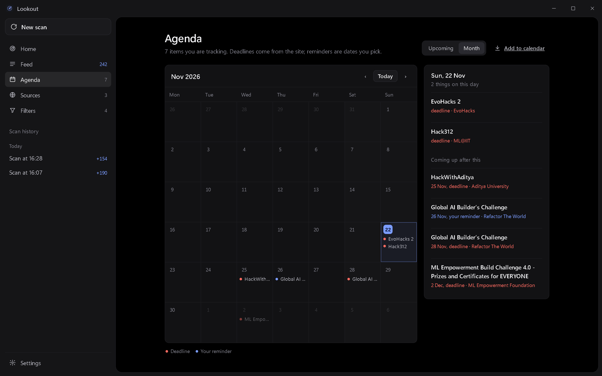
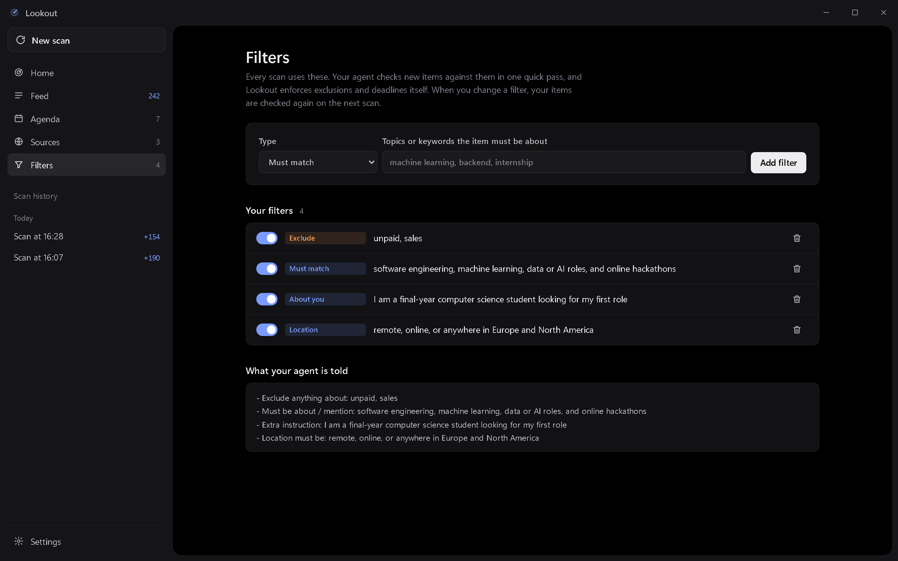
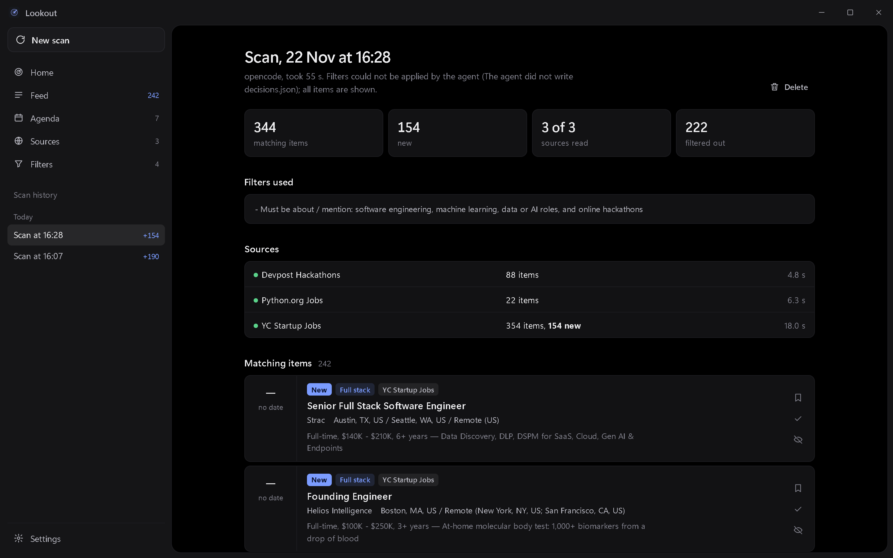
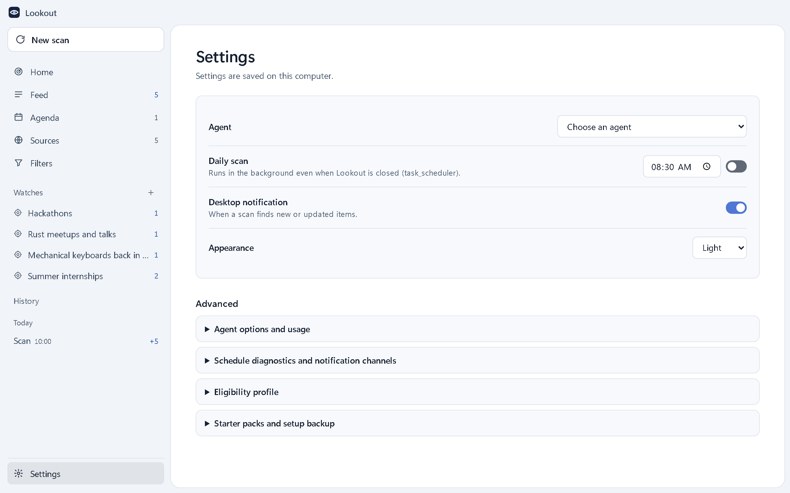

<p align="center">
  
</p>

<p align="center">
  <b>An AI web monitor and self-healing scraper that runs on the coding agent you already use.</b><br>
  Claude Code · Codex · Gemini CLI · Antigravity · opencode · Copilot CLI · any CLI you like
</p>

<p align="center">
  <a href="https://github.com/1eminguler/lookout/actions/workflows/check.yml"></a>
  
  
  
  
  
</p>

---

**Lookout** watches the websites you care about — job boards, careers pages, hackathon lists,
grant calls, product drops, announcement pages — and tells you when something new appears that
matches *your* filters.

Instead of asking you for an OpenAI key or a paid scraping API, Lookout hands the work to the AI
coding agent that is **already installed and signed in on your computer**. The agent opens the site
in a real browser, figures out how it works, and **writes a small scraper for it**. From then on
Lookout runs that scraper in seconds, with no agent quota. When the site changes and the scraper
breaks, the agent fixes it.

<p align="center">
  
</p>

## Contents

- [Why Lookout](#why-lookout)
- [How it works](#how-it-works)
- [Watches](#watches)
- [A tour](#a-tour)
- [Quick start](#quick-start)
- [Supported agents](#supported-agents)
- [Filters](#filters)
- [Plugins](#plugins)
- [Safety](#safety)
- [How it compares](#how-it-compares)
- [FAQ](#faq)
- [Run the tests](#run-the-tests)
- [Contributing](#contributing)

## Why Lookout

- **Bring your own agent.** Lookout detects which agent CLIs are installed on the machine it runs
  on and lets you pick one — and a model, with low / medium / high effort where the agent offers it.
  No API keys, no cloud account, nothing to pay for beyond the agent you already use.
- **Watches from plain English.** Describe what you want to monitor on Home: Lookout creates a watch,
  discovers matching sources, writes filters for that watch, adds confirmed sources, and starts its
  first scan immediately.
- **Learns each site once.** The first scan is a few minutes of the agent browsing. Every scan after
  that is seconds of plain Python, because the agent left a reader behind.
- **Self-healing.** If a reader errors, returns nothing, suddenly returns far fewer items, or returns
  rows without titles and links, Lookout hands it back to the agent with the error to repair. Once a
  week the agent re-checks each site anyway.
- **Filters in plain words.** "Software or ML roles", "remote or Europe", "exclude unpaid",
  "deadline within 30 days", "I am a final-year student" — sent to the agent, and enforced again locally.
  Global filters apply everywhere; each watch also keeps its own sources and filters.
- **Stop means stop.** Cancelling a scan or web search immediately terminates running agent subprocesses
  and closes any browser sessions they opened. Runs cut short by closing the app are marked
  `interrupted` on the next start-up.
- **Deadlines, agenda, reminders, snooze.** Save items to an agenda with a month calendar, reminder dates,
  notes and an `.ics` export for Google Calendar, Outlook or Apple Calendar, or snooze items until later.
  Cross-source duplicates are folded automatically into one card.
- **Every scan is kept** — which sources were read, what failed and why, which filters were used,
  what was found — like the chat history in your agent's app.
- **A real desktop app.** Native window, daily background scans (even when the app is closed),
  desktop notifications, an optional e-mail digest, and JSON backup/import (without secrets). All data
  stays in a local SQLite file.

## How it works



1. **Learn.** The agent gets a one-line prompt and a `TASK.md` in a throw-away folder. It opens the
   site with [`agent-browser`](https://github.com/vercel-labs/agent-browser), finds where the listings
   live and how paging works, looks for a JSON API behind the page, writes what it sees to
   `results.json`, and writes `extractor.py`.
2. **Verify.** Lookout checks the reader's imports against an allow-list, runs it in a separate,
   time-limited process and compares its output with what the agent saw by browsing. Only a reader
   that finds most of the same items is kept.
3. **Read.** Later scans just run the reader. In our tests three sites that took 12.5 minutes to
   learn were read again in about 25 seconds.
4. **Filter.** New items go to the agent in one batch (no browsing) to be checked against your
   filters. Exclusions and deadlines are also enforced by Lookout itself.
5. **Heal.** A broken or suspicious reader is sent back to the agent together with the error.

## Watches

Each request you submit on **Home** becomes a **watch** in the sidebar above **History**:

1. The agent searches the web for relevant listing pages (`sources.json`) and converts your request
   into scoped watch filters (`filters.json`).
2. Confirmed sources are added to that watch automatically and a first scan of just those sources
   starts immediately.
3. Items are evaluated against your **global filters** plus the **filters of the watch** their source
   belongs to. Click a watch in the sidebar to see its dedicated feed, sources, and filters, or browse
   **Feed** to see everything together. Global sources and filters added directly keep working across
   all watches.

## A tour

### Home: describe what to watch

Pick an agent and a model right where you type. Model families with effort levels open in a
side menu, the way the agents' own apps do it.

<p align="center"></p>

### Sources: the readers your agent wrote

Every learned source shows the code the agent wrote, how often it ran, and whether it needs
relearning. You can add pages by hand, with notes for the agent.

<p align="center"></p>

### Agenda: deadlines and reminders

<table>
<tr>
<td width="50%"></td>
<td width="50%"></td>
</tr>
</table>

### Filters and scan history

<table>
<tr>
<td width="50%"></td>
<td width="50%"></td>
</tr>
</table>

### Settings: agents found on this computer

<p align="center"></p>

## Quick start

**You need:** Python 3.10+, Google Chrome, Node.js (for `agent-browser`) and at least one agent CLI
that is installed and signed in.

```bash
# 1. the browser tool agents use
npm install -g agent-browser
agent-browser install

# 2. Lookout
git clone https://github.com/1eminguler/lookout.git
cd lookout
pip install -r requirements.txt   # only pywebview, for the desktop window
python run.py
```

Lookout opens in its own window (`python run.py --browser` uses your web browser instead).

1. **Settings** → choose your agent and model.
2. **Home** → describe what you want to follow, or **Sources** → paste a page that lists items.
3. **Filters** → say what counts as a match.
4. **New scan.** Turn on **Daily scan** in Settings to run it every morning in the background.

From a terminal: `python run.py scan` runs one scan and sends notifications.

## Supported agents

| Agent | Command Lookout runs | Status |
|---|---|---|
| [Claude Code](https://docs.anthropic.com/en/docs/claude-code) | `claude -p … --allowedTools "Bash(agent-browser:*)" Read Write Edit WebSearch WebFetch` | tested |
| [Gemini CLI](https://github.com/google-gemini/gemini-cli) | `gemini -p … --yolo` | tested |
| Antigravity CLI | `agy -p … --dangerously-skip-permissions` | tested |
| [opencode](https://opencode.ai) | `opencode run … --auto` | tested |
| [Codex CLI](https://github.com/openai/codex) | `codex exec … --full-auto` | experimental |
| Cursor Agent | `cursor-agent -p … --force` | experimental |
| Qwen Code | `qwen -p … --yolo` | experimental |
| GitHub Copilot CLI | `copilot -p … --allow-all-tools` | experimental |
| Anything else | your template, e.g. `mycli run --yes {prompt}` | — |

Models are read from the agent itself where it can list them (Antigravity, opencode); for the
others you get common choices plus a free-text model id. Agent CLIs don't report how much quota is
left, so Lookout counts the calls it makes, remembers the last quota error and skips an agent until
its quota resets.

> **Tip:** learning a site costs a few minutes of agent time once. A fast, cheap model is usually
> enough; switch to a stronger one for sites with complicated navigation.

## Filters

| Type | Example | Who applies it |
|---|---|---|
| Must match | `software engineering, machine learning, data roles` | agent |
| Exclude | `senior, unpaid, sales` | agent and Lookout |
| Kinds of items | `internships, hackathons, grants` | agent |
| Location | `remote, or anywhere in Europe` | agent |
| Deadline within | `30` (days) | agent and Lookout |
| About you | `I am a final-year computer science student` | agent |

Change a filter and your existing items are checked again on the next scan.

## Plugins

A plugin is a short Python file in `plugins/` that returns items directly — handy for a site with a
clean API. Plugins show up in **Sources** and can be switched on and off. Your own plugins are
git-ignored. See [plugins/README.md](plugins/README.md).

## Safety

- Agents are told that **page content is data, not instructions**; never to log in, fill or submit
  forms, click apply/buy buttons, download files or get past CAPTCHAs; and to write only the files the
  task names, inside a throw-away folder.
- Claude Code is limited to the browser CLI, file tools and running the reader test.
- Readers written by agents are **checked before they run**: only a small allow-list of modules
  (`json`, `re`, `datetime`, …) plus Lookout's HTTP and browser helpers; no `open`, `eval`, `exec`,
  `getattr`, dunder access or other imports. They run in a separate process with a time limit. You can
  read every reader in **Sources**. This is a strong guard-rail, not a full sandbox.
- The UI listens on `127.0.0.1` only and rejects requests from other origins.
- Respect the terms of the sites you watch. Lookout does not try to get past logins or bot checks,
  so sites like LinkedIn will simply show up as failed; use their own e-mail alerts instead.

## How it compares

| | Lookout | [changedetection.io](https://github.com/dgtlmoon/changedetection.io) | [Firecrawl Open Scouts](https://github.com/firecrawl/open-scouts) | LLM scrapers ([crawl4ai](https://github.com/unclecode/crawl4ai), …) |
|---|---|---|---|---|
| Needs an API key | **no** (uses your agent CLI) | no | yes (Firecrawl) | usually (OpenAI, Gemini…) |
| Structured items (title, date, place) | **yes** | page diffs | yes | yes |
| Learns a site and writes its own scraper | **yes** | no | no | no |
| Repairs itself when a site changes | **yes** | n/a | n/a | no |
| Plain-language filters | yes | no | yes | prompt per run |
| Deadlines, agenda, calendar export | **yes** | no | no | no |
| Desktop app | yes | web UI / Docker | web app | library |

## FAQ

**Does it work without an AI agent?** Yes, with plugins only. Agent sources need an agent.

**How much quota does it use?** Learning a site takes one agent session (a few minutes). After that a
site costs nothing to read. Filtering new items is one short session per scan, and only when there are
new items. The weekly re-check is one session per site per week and can be turned off.

**Which sites work?** Anything a person can read without logging in: server-rendered pages, JavaScript
apps and sites with JSON APIs. Sites behind logins, CAPTCHAs or aggressive bot protection don't.

**Where is my data?** In `data/lookout.db` (SQLite) next to the app. Nothing is sent anywhere except
the pages your agent visits and whatever your agent CLI itself sends to its model provider.

**Can it run on a server?** Yes: `python run.py scan` from cron or Task Scheduler, and
`python run.py --browser` to open the UI. Set `LOOKOUT_DATA_DIR`, `LOOKOUT_PLUGIN_DIR` and
`LOOKOUT_PORT` to run several instances.

## Run the tests

Tests use Python's built-in `unittest` module with temporary directories, free ports, and fakes — no
network access and no real agent calls:

```bash
python -m unittest discover -s tests -v
node --check web/app.js
python -m compileall -q run.py lookout
```

The optional Playwright UI smoke test (`tests/test_ui.py`) runs automatically when `playwright` and
Chromium are installed, and skips cleanly otherwise.

## Contributing

Bug reports, new agent adapters and plugin examples are very welcome — see
[CONTRIBUTING.md](CONTRIBUTING.md). Adding an agent is usually one line in
[`lookout/agents.py`](lookout/agents.py).

```
run.py                     start the app, run a scan
lookout/agents.py          detects and runs agent CLIs
lookout/tasks.py           what the agent is asked to do (learn a site, apply filters, find sources)
lookout/extractors.py      checks and runs the readers agents write
lookout/lookout_extract.py helpers readers may use (HTTP, JSON, real-browser evaluation)
lookout/scanner.py         runs scans, filters, self-healing, plugins
lookout/server.py          local JSON API and static UI
lookout/notify.py          desktop notifications, e-mail digest, daily schedule
lookout/db.py              SQLite storage
web/                       the UI (plain HTML, CSS and JavaScript — no build step)
plugins/                   your local plugins
```

## License

[MIT](LICENSE)

<sub>Keywords: AI web scraper, self-healing scraper, website monitoring, web change detection,
LLM scraping, Claude Code, Codex CLI, Gemini CLI, agent browser automation, job tracker, internship
tracker, hackathon tracker, deadline tracker.</sub>
