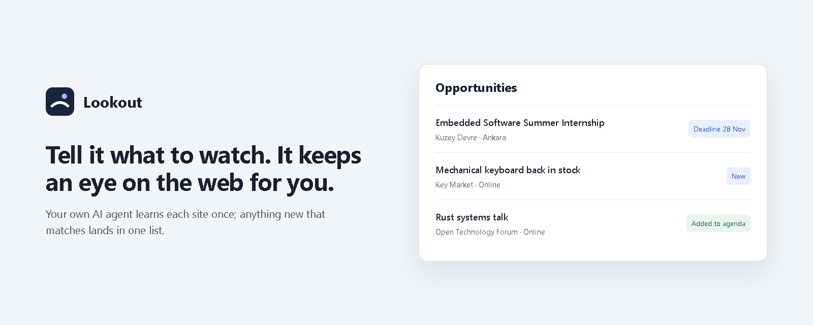
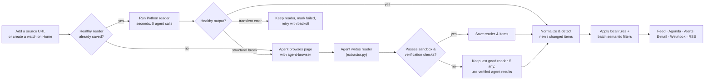
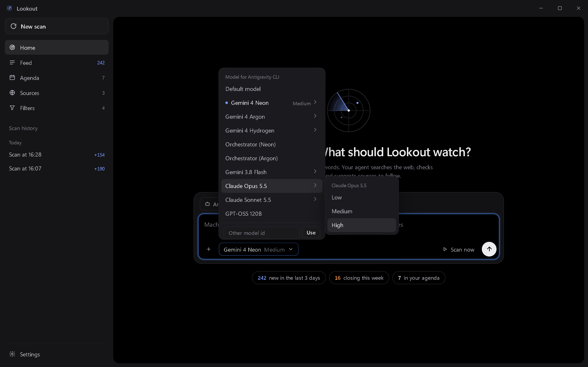

<p align="center">
  
</p>

<p align="center">
  <b>A local web monitor with self-healing readers powered by the coding-agent CLI you already use.</b><br>
  Tested adapters: Claude Code · Gemini CLI · Antigravity CLI · opencode &nbsp;|&nbsp; Experimental: Codex CLI · Cursor Agent · Qwen Code · Copilot CLI · custom CLI
</p>

<p align="center">
  <a href="https://github.com/1eminguler/lookout/actions/workflows/check.yml"></a>
  
  
  
  
  
</p>

---

**Lookout** monitors job boards, careers pages, hackathon lists, grant calls, product drops, and announcement pages — and notifies you when matching items appear or change.

Instead of asking for a separate LLM API key, Lookout delegates browser inspection and code generation to a coding-agent CLI **you already have installed, signed in, and subscribed to**. On first sight of a website, the agent browses it and writes a reusable Python **reader** (`extractor.py`). Subsequent scans run that Python reader directly in seconds without calling the agent. When a site's HTML or API layout breaks, Lookout sends the reader back to your agent to repair.

> **Important expectations before you start:**
> - **Agent subscription & quota:** Lookout uses no separate LLM API key, **not** free unlimited compute — you still need an active, signed-in agent subscription and spend its quota during source discovery, learning/healing, and semantic filtering.
> - **What stays local vs. what leaves your machine:** Your watches, sources, learned readers, items, filters, and scan history are stored locally in `data/lookout.db`. However, **visited web pages, item details, and filter prompts are sent to your chosen agent CLI and its model provider** during discovery, learning/healing, and filtering. Ordinary read scans with healthy readers contact only the monitored websites (plus any notifications you enable).
> - **Agent safety:** Only Claude Code runs with CLI-level tool restrictions; the other built-in adapters pass auto-approve flags (`--yolo`, `--dangerously-skip-permissions`, `--auto`, etc.). See [Safety & Security](#safety--security) and [SECURITY.md](SECURITY.md) before scanning untrusted sites.

<p align="center">
  
</p>

## Contents

- [Core concepts: where to start](#core-concepts-where-to-start)
- [How it works](#how-it-works)
- [First-run time and quota expectations](#first-run-time-and-quota-expectations)
- [How self-healing works — and its limits](#how-self-healing-works--and-its-limits)
- [A tour](#a-tour)
- [Quick start](#quick-start)
- [Supported agents & permission modes](#supported-agents--permission-modes)
- [Filters](#filters)
- [Plugins](#plugins)
- [Which sites work (and legal / ToS note)](#which-sites-work-and-legal--tos-note)
- [Scheduling, notifications & backups](#scheduling-notifications--backups)
- [Safety & Security](#safety--security)
- [How it compares](#how-it-compares)
- [Troubleshooting](#troubleshooting)
- [Uninstall](#uninstall)
- [Run the tests](#run-the-tests)
- [Contributing](#contributing)

## Core concepts: where to start

Lookout has four building blocks. Pick the entry point that matches how you work:

1. **Watches (start on Home if you want AI discovery):** A **watch** is a topic folder in the sidebar (e.g., *"ML internships in Berlin"*). Describe what you want on **Home**: Lookout creates a watch, searches the web for listing pages, turns your prompt into watch filters, adds the confirmed sources, and runs the watch's first scan.
2. **Sources (start on Sources if you already know the URLs):** A **source** is a single listing page (or local plugin). Sources can belong to a specific watch or stay **global** (shown in the main **Feed**). If the same URL is added across multiple watches, Lookout can share one learned reader rather than relearning the same page repeatedly.
3. **Filters — global vs. watch:**
   - **Global filters** (in **Filters**) apply to *every* watch and global source.
   - **Watch filters** (inside a watch's page) apply *only* to that watch's sources.
   - Deterministic rules (`exclude` keywords, `deadline_within`, expired deadlines) run locally in Python; semantic rules (`include`, `type`, `location`, `instruction`) are checked in batches by your agent.
4. **Plugins (optional, zero agent quota):** Short Python scripts in `plugins/` for sites with clean public JSON APIs or fixed endpoints. Plugins appear alongside regular sources, require no agent CLI at all, and never consume agent quota.

## How it works



1. **Learn:** When a source has no saved reader yet, Lookout writes `TASK.md` in an isolated temporary folder. Your agent opens the URL in [`agent-browser`](https://github.com/vercel-labs/agent-browser), inspects the DOM and any underlying JSON/GraphQL endpoints, saves up to **200** visible listings to `results.json`, and writes `extractor.py` (the Python file implementing that source's reader).
2. **Verify:** Lookout checks `extractor.py` against a static AST allow-list (`lookout/extractors.py`), runs `fetch()` inside an isolated `python -I` subprocess (`lookout/lookout_extract.py`), and checks that the output is plausible (item counts, field fill rates, and agreement with the listings the agent saw).
3. **Read:** Subsequent scans execute the verified reader directly in Python without invoking an agent CLI. New items are normalized, deduplicated across sources, and tracked for changes (such as deadline shifts, closures, or reopenings).
4. **Filter:** Deterministic exclusions and deadline rules run locally. If semantic filters are active and new/unchecked items exist, Lookout sends them in batches (up to 80 items per batch, no web browsing) to the agent to decide matches.
5. **Heal:** When a reader fails structurally, Lookout hands it back to the agent with the error message to repair while preserving the previous working reader (`last_good_extractor`) until a replacement verifies.

## First-run time and quota expectations

Different steps use very different amounts of time and agent quota:

| Phase | Agent calls | Typical time | What happens |
|---|---|---|---|
| **Discover** (Home prompt) | 1 session | ~3–16 min (timeout `agent_timeout_min + 4`, default 16 min) | Agent searches the web, verifies candidate listing pages, drafts watch filters, and streams confirmed sources so learning can start promptly. |
| **Learn** (new or broken site) | 1 session per unlearned URL | ~2–12 min per site (capped by `agent_timeout_min`, default 12 min) | Agent drives Chromium via `agent-browser` and writes `extractor.py`. Multiple sources learn concurrently up to the **parallel** setting (default `2`), and items appear progressively as each source finishes. A new watch with 6–8 sites can easily take **10–25+ minutes** on its very first scan. |
| **Read** (healthy reader) | **0 calls** | **A few seconds** | Runs saved Python readers directly (or local plugins). No agent CLI is launched. |
| **Filter** (semantic rules) | 1 short batch call per scope with unchecked items (0 if none) | ~10–45 sec | Agent reads `items.json` locally (no browsing) in batches of up to 80 items. |
| **Weekly check** (`verify_weekly`) | **0 calls** if healthy; 1 learn session only if anomalous | Seconds when healthy | Runs the saved reader first; only launches an agent session if output looks anomalous vs. history (count drop, fill rate drop, or URL pattern change). Can be turned off in Settings. |

> **Tip:** You can watch progress per source while a first scan runs, or switch to a faster/cheaper model in the Home/Settings picker for routine sites and reserve heavier models for complex JavaScript pages.

## How self-healing works — and its limits

Lookout separates temporary network glitches from actual website redesigns:

- **Transient errors keep the reader:** Connection errors, timeouts, HTTP 5xx responses, and HTTP 429 rate limits do **not** wipe out a working reader or immediately burn agent quota. The source is marked failed for that scan and retried with backoff on later runs.
- **Structural failures trigger repair:** Syntax/runtime errors in the reader, empty results on a site that previously had open listings, sharp item-count drops, or rows missing valid titles and `http(s)` links mark the reader for relearning on the next scan.
- **Rollback protection (`last_good_extractor`):** Lookout keeps the last verified reader and promotes a newly generated replacement only after it passes verification. A failed or timed-out repair never destroys a working reader.
- **Test before saving:** Use **Test this source** in the UI to inspect parsed output for a source before relying on it.

**Where self-healing cannot see everything:**

- **Silent wrong-tab or stale-section reads:** If a site layout changes so the reader still parses plausible counts of valid-looking titles and URLs from the wrong tab (or an archive page), Lookout cannot detect semantic drift automatically. Use **Test this source** or click **Relearn** on that source.
- **Filter changes vs. learned sections:** Editing filters re-evaluates collected items, but if a reader was originally written to target a specific site category/tab (e.g., *"Full-time"* instead of *"Internships"*), click **Relearn** after changing your filters so the agent inspects the new section.

## A tour

### Home: describe what to watch

Pick an installed agent and model right in the composer. Model families with effort levels open in a side submenu.

<p align="center"></p>

### Sources: the readers your agent wrote

Inspect every source's status, test a source on demand, edit hints for the agent, request a relearn, or expand the exact Python code of each learned reader.

<p align="center"></p>

### Agenda: deadlines and reminders

Track saved items in an upcoming timeline or month calendar, add notes, snooze items, and export `.ics` events for Google Calendar, Outlook, or Apple Calendar.

<table>
<tr>
<td width="50%"></td>
<td width="50%"></td>
</tr>
</table>

### Filters and scan history

Review global and watch filters alongside the exact prompt instructions sent to the agent, and audit every scan source-by-source in History.

<table>
<tr>
<td width="50%"></td>
<td width="50%"></td>
</tr>
</table>

### Settings: agents, schedule, alerts, and backups

<p align="center"></p>

## Quick start

**Prerequisites:**

- Python 3.10+
- Google Chrome / Chromium
- Node.js (for `agent-browser`)
- At least one supported agent CLI installed and signed in (unless you only use local `plugins/`)

```bash
# 1. Install the browser CLI used by agents and JS readers
npm install -g agent-browser
agent-browser install

# 2. Clone and run Lookout
git clone https://github.com/1eminguler/lookout.git
cd lookout
pip install -r requirements.txt   # optional pywebview for desktop window; falls back to browser
python run.py
```

If `pywebview` is not installed or cannot initialize a native window backend (for example on headless Linux), Lookout automatically falls back to opening in your web browser (`python run.py --browser`).

1. Open **Settings** → pick your agent and default model.
2. Open **Home** → describe what you want to follow (creates a watch + finds sources), or go to **Sources** → add listing URLs directly.
3. Review **Filters** → refine global or watch-specific rules.
4. Run **New scan**, then optionally enable **Daily scan** and notifications in **Settings**.

From a terminal or scheduler:

```bash
python run.py scan
```

## Supported agents & permission modes

CLI flags in [`lookout/agents.py`](lookout/agents.py) marked **tested** were checked against `--help` on real installs; **experimental** adapters have not yet been verified against live installations and CLI updates from vendors can change flag behavior at any time.

| Agent | Flags passed by Lookout | Status | Permission mode |
|---|---|---|---|
| [Claude Code](https://docs.anthropic.com/en/docs/claude-code) | `claude -p … --add-dir <dir> --permission-mode acceptEdits --allowedTools "Bash(agent-browser:*)" "Bash(agent-browser *)" "Bash(python test_extractor.py)" "Bash(python3 test_extractor.py)" Read Write Edit WebSearch WebFetch` | tested | **Tool-restricted** |
| [Gemini CLI](https://github.com/google-gemini/gemini-cli) | `gemini -p … --yolo` | tested | **Auto-approve** |
| Antigravity CLI | `agy -p … --add-dir <dir> --dangerously-skip-permissions --print-timeout <t>s` | tested | **Auto-approve** |
| [opencode](https://opencode.ai) | `opencode run … --auto` | tested | **Auto-approve** |
| [Codex CLI](https://github.com/openai/codex) | `codex exec … --full-auto` | experimental | **Auto-approve** |
| Cursor Agent | `cursor-agent -p … --force` | experimental | **Auto-approve** |
| Qwen Code | `qwen -p … --yolo` | experimental | **Auto-approve** |
| GitHub Copilot CLI | `copilot -p … --allow-all-tools` | experimental | **Auto-approve** |
| Custom command | Your command template (`{prompt}`, `{model}`, `{dir}`) | custom | **User-defined** |

**Auto-approve warning:** All adapters except Claude Code run with non-interactive auto-approve flags (`--yolo`, `--dangerously-skip-permissions`, `--auto`, `--full-auto`, `--force`, `--allow-all-tools`), meaning the CLI executes tool calls without asking for confirmation. When scanning untrusted websites, prefer **Claude Code** or run Lookout inside a container or throwaway VM. See [SECURITY.md](SECURITY.md) for the full threat model.

Lookout tracks calls locally and pauses an agent/model pair when it detects a quota/429 error until its reported reset time.

## Filters

| Type | Example | Enforced by |
|---|---|---|
| Must match (`include`) | `software engineering, machine learning, data roles` | agent |
| Exclude (`exclude`) | `senior, unpaid, sales` | agent and Lookout (local regex word match) |
| Kinds of items (`type`) | `internships, hackathons, grants` | agent |
| Location (`location`) | `remote, or anywhere in Europe` | agent |
| Deadline within (`deadline_within`) | `30` (days) | agent and Lookout (local date check) |
| About you (`instruction`) | `I am a final-year computer science student` | agent |

Lookout also filters out items whose parsed deadline has already passed.

## Plugins

A plugin is a Python file in `plugins/` exposing `SOURCES = [{"name": ..., "url": ..., "fetch": fn}]`. Plugins run in-process, execute in seconds, and require zero agent calls or agent CLI setup. Files beginning with `_` are ignored by the loader (copy [`plugins/_example_hn_jobs.py`](plugins/_example_hn_jobs.py) to start). Your personal `.py` files in `plugins/` are git-ignored. See [plugins/README.md](plugins/README.md).

## Which sites work (and legal / ToS note)

- **Works well:** Public server-rendered HTML listing pages, public JavaScript single-page apps readable without signing in, public JSON/GraphQL APIs behind listing pages, and official organization careers, grants, or competition portals.
- **Works poorly or fails:** Sites behind logins or paywalls, aggressive bot walls/CAPTCHAs (such as Cloudflare Turnstile or DataDome), multi-step authenticated forms, or pages whose listings lack titles or item URLs.
- **Legal & Terms of Service:** Respect each site's Terms of Service, `robots.txt`, and reasonable request rates. Lookout does not bypass logins, paywalls, or anti-bot/CAPTCHA checks; for platforms that prohibit automated reading (such as major social or professional networks), use their native email alerts or official APIs instead. You are responsible for ensuring your configured sources comply with applicable site terms and laws.

## Scheduling, notifications & backups

### Daily background scans

Enable **Daily scan** in **Settings** to run `python run.py scan --scheduled` automatically once a day, even when the UI is closed. A cross-process lock in SQLite prevents scheduled scans and manual UI scans from running concurrently.

- **Windows:** Registers a Windows Task Scheduler task named `LookoutDailyScan` (with missed-run catch-up).
- **macOS:** Installs a `launchd` user agent (`com.lookout.dailyscan` in `~/Library/LaunchAgents/`) or falls back to a user `crontab` entry.
- **Linux:** Installs a `systemd --user` timer (`lookout-scan.timer` and `lookout-scan.service` in `~/.config/systemd/user/`) or falls back to a user `crontab` entry.

### Notifications and feeds

- **Desktop alerts:** Windows toast (`powershell.exe`), macOS Notification Center (`osascript`), or Linux (`notify-send`) when new items arrive or agenda reminders are due.
- **E-mail digest (optional):** Sends matched new items via SMTP with TLS certificate verification (`ssl.create_default_context()`), supporting both STARTTLS (e.g., port `587`) and SMTP over SSL (port `465`). Note that `smtp_password` is stored in `data/lookout.db` (not an OS keyring).
- **Webhooks (optional):** Sends a JSON POST payload when new items are found, and formats plain-text headers/body automatically for `ntfy` topic URLs. Private/loopback webhook targets are blocked by default unless explicitly opted in.
- **Per-watch RSS/Atom (optional):** Disabled by default; can be enabled in Settings if you want an RSS reader to subscribe to a watch.

### Backup scope (read before relying on JSON export)

- **JSON export/import (`/api/backup.json`):** Exports and imports **watches, non-plugin sources, and filters ONLY**. It **intentionally omits** secrets (`smtp_password`), **learned readers**, **collected items**, **agenda notes/reminders**, and **scan/discovery history**. Restoring from JSON into a fresh database requires relearning each source on the next scan.
- **Full backup:** Stop Lookout and copy `data/lookout.db` (or the entire `data/` directory) to preserve learned readers, items, agenda state, history, and settings.

## Safety & Security

- **API boundary:** Binds only to `127.0.0.1`, validates `Host` and `Origin` headers, requires a random per-launch token on `/api/*` routes, gates `custom_command` edits behind confirmation plus metacharacter checks, and escapes CSV formulas (`= + - @ \t \r`) and `.ics` fields (`\r`, line folding, UTC `DTSTAMP`).
- **SSRF protection:** Reader HTTP/browser helpers (`lookout/lookout_extract.py`) and webhooks (`lookout/notify.py`) resolve DNS and block loopback, RFC 1918 private, link-local, CGNAT, multicast, unspecified, and local IPv6/hostname targets across HTTP redirects (subject to standard application-level DNS TOCTOU limits).
- **Reader sandbox:** Generated readers (`extractor.py`) are checked against a single-source-of-truth AST allow-list and executed inside an isolated `python -I` subprocess with restricted builtins, output/HTTP byte caps, timeouts, and process-tree termination. This is a defense-in-depth guard-rail, not a kernel or VM sandbox, and `browser_eval()` launches Chromium via `agent-browser`.

See **[SECURITY.md](SECURITY.md)** for the full threat model, exact per-agent CLI flags, and private vulnerability reporting.

## How it compares

| | Lookout | [changedetection.io](https://github.com/dgtlmoon/changedetection.io) | [Firecrawl Open Scouts](https://github.com/firecrawl/open-scouts) | LLM libraries ([crawl4ai](https://github.com/unclecode/crawl4ai), …) |
|---|---|---|---|---|
| **Cost / API requirement** | Uses your existing agent CLI subscription (0 agent calls on healthy reads) | **Zero LLM cost** (free self-hosted) | Firecrawl API key | LLM API keys per run |
| **Extraction model** | Agent writes a reusable Python reader per site | Mature visual CSS/XPath/JSON selectors & text/HTML diffs | Managed cloud search & extraction | Code-driven LLM/DOM extraction |
| **Layout-change handling** | Agent repairs broken readers (with last-good rollback) | Alerts on selector errors / diffs | Managed service | You update selectors/prompts |
| **Logins & browser steps** | **No** (public pages only) | **Yes** (Playwright/Puppeteer browser steps & logins) | Public web | Configurable in code |
| **Filtering** | Plain-language batch agent filter + local rules | Text/regex/JSONPath triggers | Natural-language prompts | Custom code / LLM prompts |
| **Notifications** | Desktop, TLS SMTP, JSON/ntfy webhooks, optional RSS | **Apprise** (dozens of services), webhooks, e-mail | Web app notifications | DIY |
| **Deadlines & agenda** | Built-in deadline parsing, item change tracking, agenda & `.ics` | General page monitoring (no agenda) | Monitoring results | DIY |
| **Deployment & maturity** | Local desktop-first Python/SQLite app | **Mature, official Docker image, server-ready** | Hosted / web app | Python library |

## Troubleshooting

- **Desktop window doesn't open (e.g., Linux without GTK/Qt WebKit):** Run `python run.py --browser`. On `pywebview` startup failures, `run.py` automatically falls back to opening your default web browser.
- **"`agent-browser` is missing" banner in Settings:** Install Node.js and Google Chrome/Chromium, then run `npm install -g agent-browser && agent-browser install`.
- **Agent quota exhausted (`quota is used up until ...`):** Agent CLIs don't expose remaining quota upfront, so Lookout detects quota/429 responses and pauses that agent/model until reset. Switch to another agent or lighter model, disable `verify_weekly`, or convert high-frequency JSON sites into `plugins/`.
- **Running on a headless machine or home server:** Lookout binds strictly to `127.0.0.1` and enforces `Host`, `Origin`, and per-launch API token checks — **putting a reverse proxy in front of Lookout will return `403` / `401`**. Run scheduled scans with `python run.py scan` and access the UI securely via an SSH local port forward:
  ```bash
  ssh -L 8780:127.0.0.1:8780 user@your-server
  ```
  Then open `http://127.0.0.1:8780` in your local browser.
- **Stuck or interrupted scan after force-quitting:** Restarting Lookout marks orphaned `running` records as `interrupted`; a cross-process lock in SQLite prevents scheduled and manual scans from colliding.

## Uninstall

1. Stop Lookout if it is running (close the desktop window or terminate `python run.py`).
2. **Remove the daily scan schedule** (turn **Daily scan** off in **Settings** before deleting files, or run the manual cleanup for your OS):
   - **Windows:**
     ```powershell
     schtasks /Delete /TN LookoutDailyScan /F
     ```
   - **Linux (`systemd --user`):**
     ```bash
     systemctl --user disable --now lookout-scan.timer
     rm -f ~/.config/systemd/user/lookout-scan.service ~/.config/systemd/user/lookout-scan.timer
     systemctl --user daemon-reload
     ```
   - **macOS (`launchd`):**
     ```bash
     launchctl bootout gui/$(id -u) ~/Library/LaunchAgents/com.lookout.dailyscan.plist 2>/dev/null || launchctl unload ~/Library/LaunchAgents/com.lookout.dailyscan.plist
     rm -f ~/Library/LaunchAgents/com.lookout.dailyscan.plist
     ```
   - **macOS / Linux (`crontab`):** run `crontab -e` and delete the line ending in `# lookout-daily-scan`.
3. Delete the cloned `lookout` directory (including `data/lookout.db` and `plugins/`, or back up `data/lookout.db` first if you want to keep your database). You can also remove temporary work folders `lookout_agent` and `lookout_extractor` from your OS temp directory if any remain.

## Run the tests

Tests use Python's built-in `unittest` module with temporary directories, ephemeral local ports, and fakes — no external network access and no real agent calls:

```bash
python -m unittest discover -s tests -v
node --check web/app.js
python -m compileall -q run.py lookout plugins tests
```

The optional Playwright UI smoke test (`tests/test_ui.py`) runs automatically when `playwright` and Chromium are installed, and skips cleanly otherwise.

## Contributing

Bug reports, security improvements, agent adapter updates, and plugin examples are welcome — see [CONTRIBUTING.md](CONTRIBUTING.md) and [SECURITY.md](SECURITY.md).

```
run.py                     app launcher, desktop window fallback, CLI scan command
lookout/agents.py          detects and runs agent CLIs
lookout/tasks.py           prompts and runners for Discover, Learn/Heal, and Classify
lookout/extractors.py      AST check and isolated subprocess runner for readers
lookout/lookout_extract.py single-source-of-truth sandbox constants, SSRF checks, HTTP & browser helpers
lookout/scanner.py         runs scans, normalizes items, filters, self-healing, plugins
lookout/server.py          local loopback web UI & token-protected JSON/CSV/ICS/RSS API
lookout/notify.py          desktop alerts, TLS SMTP digest, webhooks, per-OS scheduling
lookout/db.py              SQLite storage, migrations, scan lock, item history
web/                       frontend UI (plain HTML, CSS, and JavaScript — no build step)
plugins/                   optional zero-agent local Python source plugins
tests/                     offline unittest suite and local test helpers
SECURITY.md                threat model, agent permission flags, sandbox & SSRF boundaries
```

## License

[MIT](LICENSE)
